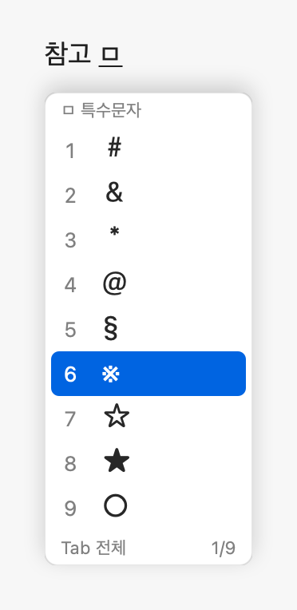
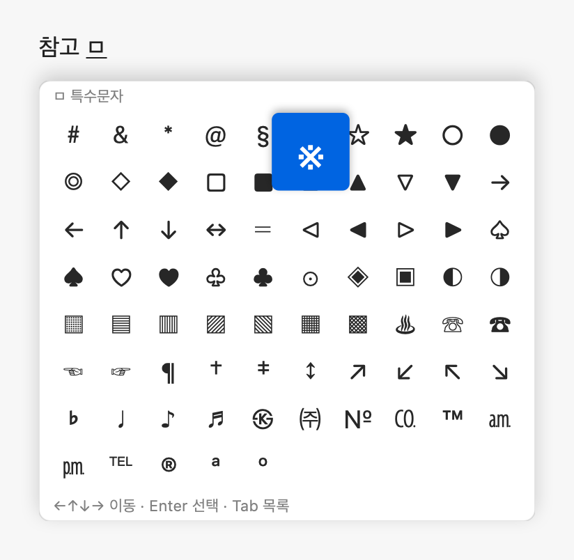
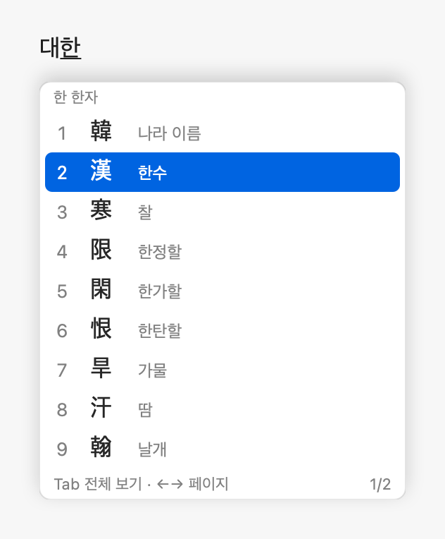
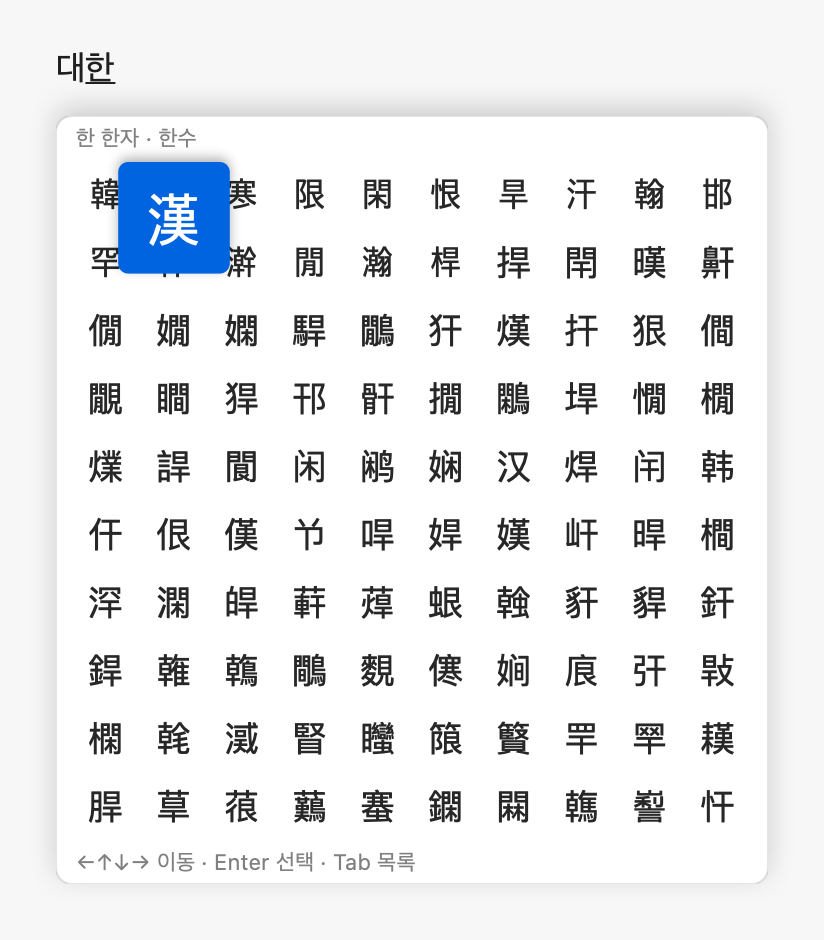

# MHanja

macOS 메뉴바 앱. 윈도우 한글 입력기처럼 **자음 + 트리거 키**로 특수문자를, **한글 + 트리거 키**로 한자를 입력합니다.

| | 목록 | `Tab` 전체 보기 |
|---|---|---|
| **특수문자**<br>`ㅁ` + 트리거 키 | <picture><source media="(prefers-color-scheme: dark)" srcset="docs/screenshots/symbols-list-dark.png"></picture> | <picture><source media="(prefers-color-scheme: dark)" srcset="docs/screenshots/symbols-grid-dark.png"></picture> |
| **한자**<br>`한` + 트리거 키 | <picture><source media="(prefers-color-scheme: dark)" srcset="docs/screenshots/hanja-list-dark.png"></picture> | <picture><source media="(prefers-color-scheme: dark)" srcset="docs/screenshots/hanja-grid-dark.png"></picture> |

## 사용법

macOS 기본 입력기(두벌식)를 그대로 쓰면서, 글자를 입력한 직후 트리거 키(기본: 오른쪽 Option)를 눌렀다 뗍니다.

| 입력 | 결과 |
|---|---|
| 자음 + 트리거 키 (예: `ㅁ`) | 특수문자 목록 (`※ ☆ ★ → …`), 윈도우 KS X 1001 배열과 같음 |
| 한글 음절 + 트리거 키 (예: `한`) | 한자 목록과 훈 (`韓 나라 이름`, `漢 한수` …) |

목록에서:

- `↑` `↓` 선택, `←` `→` 페이지, 숫자 `1`–`9` 바로 선택, `Enter` 입력, `Esc` 닫기
- `Tab` 전체 보기 — 모든 문자를 격자로 펼칩니다. 한자는 기본 목록에 KS X 1001 한자만 보이고, 전체 보기에서 나머지 한자까지 보입니다.

메뉴바 아이콘에서 사용 여부, 트리거 키, 로그인 시 실행을 설정할 수 있습니다.
트리거 키는 오른쪽 Option / Command / Control 중에서 고르거나, **사용자 정의…**에서 원하는 키를 직접 눌러 정합니다. 보조키 하나(왼쪽 Option, Fn 등)를 눌렀다 떼는 방식과 `⌃Space`·`F13` 같은 키 조합을 쓸 수 있고, macOS 키보드 단축키나 실행 중인 앱의 메뉴 단축키와 겹치면 알려 줍니다.
새 버전이 [Releases](../../releases)에 올라오면 알려 줍니다(하루 한 번 확인, 메뉴의 **업데이트 확인…**으로 바로 확인).

처음 실행하면 **시스템 설정 > 개인정보 보호 및 보안 > 손쉬운 사용**에서 MHanja를 허용해야 합니다. 키 입력 감지와 커서 위치 확인에 필요합니다.

## 설치

[Releases](../../releases)에서 Mac의 CPU에 맞는 DMG를 받아 열고, MHanja를 응용 프로그램 폴더로 끌어다 놓습니다.

| Mac | 파일 |
|---|---|
| Apple Silicon (M1 이후) | `MHanja-AppleSilicon.dmg` |
| Intel | `MHanja-Intel.dmg` |

어느 쪽인지는  메뉴 > **이 Mac에 관하여**의 "칩"(Apple M…) 또는 "프로세서"(Intel …)로 알 수 있습니다.

Apple 공증을 받지 않은 앱이라 처음 실행하면 macOS가 막습니다. 다음 순서로 한 번만 허용하면 됩니다.

1. MHanja를 실행합니다 → "열 수 없음" 경고가 뜨면 **완료**(또는 취소)를 누릅니다.
2. **시스템 설정 > 개인정보 보호 및 보안**을 열고, 아래쪽의 "MHanja이(가) 차단되었습니다" 옆 **그래도 열기**를 누릅니다.
3. 다시 확인 창에서 **열기**를 누릅니다. (macOS 14 이하는 앱을 우클릭 > **열기**로도 됩니다.)

요구 사항: macOS 13 이상

## 프로젝트 구성

```text
Sources/MHanja/      앱 소스
  KeyMonitor.swift       전역 키 감시, 트리거 키 감지
  Trigger.swift          트리거 키 (보조키 단독 / 키 조합)
  TriggerRecorder.swift  트리거 키 사용자 정의 창
  ShortcutConflicts.swift  단축키 충돌 검사
  HangulTracker.swift    입력 중인 자음/음절 추적
  CandidatePanel.swift   후보 목록 창 (목록·격자)
  HanjaDictionary.swift  한자 사전 (기본/전체 목록, 훈 추출)
  SymbolTable.swift      자음별 특수문자 표
  TextInserter.swift     글자 바꿔 넣기, 커서 위치 찾기
Resources/           한자 사전 데이터, 앱 아이콘
design/              아이콘·DMG 배경 원본과 생성 코드, 스크린샷 생성 스크립트
docs/screenshots/    README 스크린샷 (./design/make-screenshots.sh로 다시 만듦)
build.sh             앱 번들·DMG 빌드 (Apple Silicon·Intel 따로)
```

## 라이선스

MIT License — [LICENSE](LICENSE)

한자 사전 데이터(`Resources/hanja.tsv`)는 [libhangul](https://github.com/libhangul/libhangul)의 `data/hanja/hanja.txt`를 가공한 것으로, BSD 3-Clause 라이선스를 따릅니다 — [Resources/hanja-LICENSE.txt](Resources/hanja-LICENSE.txt)

문의/건의: ifmtplaystore@gmail.com
